# FOODPOS — Entity Relationship Diagram (ERD)

Diagram relasi database PostgreSQL untuk FOODPOS mencakup seluruh modul: Multi-outlet, Identity & RBAC, Produk & Katalog, Pelanggan, Pesanan & Snapshot, Pembayaran & Refund, Inventori Produk Jadi, Kasir & Keuangan, serta Pengaturan & Audit.

```mermaid
erDiagram
    OUTLETS ||--o{ PROFILES : "assigned to"
    OUTLETS ||--o{ CATEGORIES : "owns"
    OUTLETS ||--o{ PRODUCTS : "owns"
    OUTLETS ||--o{ ORDERS : "receives"
    OUTLETS ||--o{ ORDER_PAYMENTS : "collects"
    OUTLETS ||--o{ STOCK_MOVEMENTS : "tracks"
    OUTLETS ||--o{ CASH_SESSIONS : "operates"
    OUTLETS ||--o{ EXPENSES : "records"
    OUTLETS ||--|| STORE_SETTINGS : "configures"
    OUTLETS ||--|| PAYMENT_SETTINGS : "configures"
    OUTLETS ||--|| TAX_SETTINGS : "configures"
    OUTLETS ||--|| SERVICE_CHARGE_SETTINGS : "configures"

    PROFILES ||--o{ USER_ROLES : "has"
    ROLES ||--o{ USER_ROLES : "assigned to"
    ROLES ||--o{ ROLE_PERMISSIONS : "contains"
    PERMISSIONS ||--o{ ROLE_PERMISSIONS : "granted by"
    PROFILES ||--o{ USER_OUTLETS : "has access to"
    OUTLETS ||--o{ USER_OUTLETS : "accessed by"

    CATEGORIES ||--o{ PRODUCTS : "groups"
    PRODUCTS ||--o{ PRODUCT_VARIANTS : "has variants"
    PRODUCTS ||--o{ PRODUCT_ADDONS : "has addons"
    PRODUCTS ||--o{ STOCK_MOVEMENTS : "has stock history"

    CUSTOMERS ||--o{ ORDERS : "places"
    ORDERS ||--o{ ORDER_ITEMS : "contains"
    ORDERS ||--o{ ORDER_STATUS_HISTORY : "tracks transitions"
    ORDERS ||--o{ ORDER_PAYMENTS : "settled by"
    ORDERS ||--o{ PUBLIC_ORDER_TOKENS : "authorized by"

    ORDER_PAYMENTS ||--o{ PAYMENT_REFUNDS : "refunded via"
    ORDER_PAYMENTS ||--o{ PAYMENT_EVENTS : "logs status changes"

    CASH_SESSIONS ||--o{ CASH_TRANSACTIONS : "contains"
    CASH_SESSIONS ||--o{ EXPENSES : "funds"

    OUTLETS ||--o{ AUDIT_LOGS : "logs activity"
    OUTLETS ||--o{ NOTIFICATIONS : "broadcasts"

    OUTLETS {
        uuid id PK
        varchar code UK
        text name
        text address
        varchar phone
        boolean is_active
        timestamptz created_at
        timestamptz updated_at
    }

    PROFILES {
        uuid id PK
        text full_name
        varchar phone
        text avatar_url
        timestamptz created_at
        timestamptz updated_at
    }

    ROLES {
        uuid id PK
        varchar name UK
        text description
        timestamptz created_at
    }

    PERMISSIONS {
        uuid id PK
        varchar code UK
        varchar module
        text description
        timestamptz created_at
    }

    ROLE_PERMISSIONS {
        uuid id PK
        uuid role_id FK
        uuid permission_id FK
        timestamptz created_at
    }

    USER_ROLES {
        uuid id PK
        uuid user_id FK
        uuid role_id FK
        timestamptz created_at
    }

    USER_OUTLETS {
        uuid id PK
        uuid user_id FK
        uuid outlet_id FK
        boolean is_primary
        timestamptz created_at
    }

    CATEGORIES {
        uuid id PK
        uuid outlet_id FK
        text name
        text slug
        text description
        integer display_order
        boolean is_active
        timestamptz created_at
        timestamptz updated_at
    }

    PRODUCTS {
        uuid id PK
        uuid outlet_id FK
        uuid category_id FK
        varchar sku
        text name
        text description
        numeric base_price
        text image_url
        boolean is_active
        boolean is_available
        integer display_order
        integer current_stock
        timestamptz created_at
        timestamptz updated_at
    }

    PRODUCT_VARIANTS {
        uuid id PK
        uuid product_id FK
        text name
        numeric price_adjustment
        boolean is_active
        integer display_order
        timestamptz created_at
    }

    PRODUCT_ADDONS {
        uuid id PK
        uuid product_id FK
        text name
        numeric price
        boolean is_active
        integer display_order
        timestamptz created_at
    }

    CUSTOMERS {
        uuid id PK
        uuid outlet_id FK
        text name
        varchar phone
        varchar email
        text address
        text notes
        timestamptz created_at
        timestamptz updated_at
    }

    ORDERS {
        uuid id PK
        uuid outlet_id FK
        uuid customer_id FK
        varchar order_number UK
        varchar channel
        varchar service_type
        varchar order_status
        text customer_name_snapshot
        varchar customer_phone_snapshot
        text delivery_address_snapshot
        numeric subtotal
        numeric discount_amount
        numeric tax_amount
        numeric service_charge_amount
        numeric delivery_fee
        numeric grand_total
        text notes
        uuid created_by FK
        timestamptz created_at
        timestamptz updated_at
    }

    ORDER_ITEMS {
        uuid id PK
        uuid order_id FK
        uuid product_id FK
        text product_name_snapshot
        varchar sku_snapshot
        text variant_name_snapshot
        jsonb addons_snapshot
        numeric unit_price
        integer quantity
        numeric discount_amount
        numeric line_total
        text item_notes
        timestamptz created_at
    }

    ORDER_STATUS_HISTORY {
        uuid id PK
        uuid order_id FK
        varchar previous_status
        varchar new_status
        uuid actor_id FK
        text actor_name
        text reason
        timestamptz created_at
    }

    PUBLIC_ORDER_TOKENS {
        uuid id PK
        uuid order_id FK
        varchar token_hash UK
        timestamptz expires_at
        timestamptz created_at
    }

    ORDER_PAYMENTS {
        uuid id PK
        uuid outlet_id FK
        uuid order_id FK
        varchar payment_method
        varchar status
        numeric amount
        numeric cash_received
        numeric change_amount
        varchar reference_number
        text proof_path
        uuid verified_by FK
        timestamptz verified_at
        varchar idempotency_key UK
        timestamptz created_at
        timestamptz updated_at
    }

    PAYMENT_REFUNDS {
        uuid id PK
        uuid outlet_id FK
        uuid payment_id FK
        numeric refund_amount
        text reason
        varchar status
        uuid requested_by FK
        uuid approved_by FK
        timestamptz approved_at
        timestamptz refunded_at
        varchar refund_reference
        timestamptz created_at
    }

    PAYMENT_EVENTS {
        uuid id PK
        uuid payment_id FK
        varchar event_type
        varchar previous_status
        varchar new_status
        uuid actor_id FK
        text notes
        timestamptz created_at
    }

    PAYMENT_SETTINGS {
        uuid id PK
        uuid outlet_id FK
        text qris_image_url
        text qris_merchant_name
        varchar bank_name
        varchar bank_account_number
        varchar bank_account_holder
        boolean is_cash_enabled
        boolean is_qris_enabled
        boolean is_transfer_enabled
        boolean is_card_enabled
        timestamptz updated_at
    }

    TAX_SETTINGS {
        uuid id PK
        uuid outlet_id FK
        boolean is_enabled
        numeric tax_rate_percent
        varchar tax_name
        timestamptz updated_at
    }

    SERVICE_CHARGE_SETTINGS {
        uuid id PK
        uuid outlet_id FK
        boolean is_enabled
        numeric service_rate_percent
        timestamptz updated_at
    }

    STOCK_MOVEMENTS {
        uuid id PK
        uuid outlet_id FK
        uuid product_id FK
        varchar movement_type
        integer quantity_change
        integer previous_stock
        integer new_stock
        varchar reference_id
        text reason
        uuid actor_id FK
        timestamptz created_at
    }

    CASH_SESSIONS {
        uuid id PK
        uuid outlet_id FK
        uuid opened_by FK
        uuid closed_by FK
        timestamptz opened_at
        timestamptz closed_at
        numeric opening_cash
        numeric total_cash_sales
        numeric total_non_cash_sales
        numeric total_cash_in
        numeric total_cash_out
        numeric expected_closing_cash
        numeric actual_closing_cash
        numeric discrepancy
        varchar status
        text closing_notes
        timestamptz created_at
    }

    CASH_TRANSACTIONS {
        uuid id PK
        uuid session_id FK
        varchar transaction_type
        numeric amount
        text reason
        uuid actor_id FK
        timestamptz created_at
    }

    EXPENSES {
        uuid id PK
        uuid outlet_id FK
        uuid session_id FK
        text title
        varchar category
        numeric amount
        varchar payment_method
        text notes
        text receipt_proof_url
        uuid created_by FK
        timestamptz created_at
    }

    STORE_SETTINGS {
        uuid id PK
        uuid outlet_id FK
        text business_name
        text business_tagline
        text description
        text logo_url
        text banner_url
        text operating_hours
        varchar whatsapp_number
        varchar email
        text google_maps_url
        integer estimated_prep_time_minutes
        boolean is_online_ordering_enabled
        timestamptz updated_at
    }

    NOTIFICATIONS {
        uuid id PK
        uuid outlet_id FK
        uuid recipient_user_id FK
        text title
        text message
        varchar type
        boolean is_read
        jsonb metadata
        timestamptz created_at
    }

    AUDIT_LOGS {
        uuid id PK
        uuid outlet_id FK
        uuid actor_id FK
        varchar actor_email
        varchar action
        varchar entity_type
        varchar entity_id
        jsonb details
        varchar ip_address
        timestamptz created_at
    }
```

